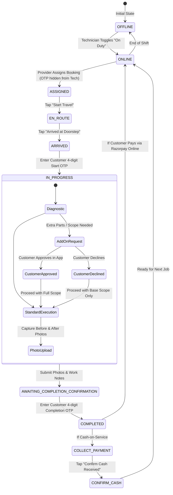

# HomeServe - Software Requirements Specification (SRS)
## Complete Home Services Booking SaaS Platform

---

### Document Control
- **Document Title:** Software Requirements Specification (SRS) & System Architecture Blueprint
- **Project Name:** HomeServe SaaS Platform
- **Document Version:** 1.3.0 (Phase 2 Final Consistency Corrections)
- **Status:** Approved for Implementation Blueprint
- **Target Tech Stack:** React.js, Vite, Tailwind CSS, Python FastAPI (Synchronous SQLAlchemy 2.0), MySQL 8.0 + PyMySQL, Alembic, JWT Authentication, Razorpay Test Mode
- **Currency & Precision:** Indian Rupee (₹ / INR), Database storage and calculation in Integer Paise ($1\text{ INR} = 100\text{ Paise}$)
- **Timezone Standard:** Stored in UTC (`TIMESTAMP` / ISO-8601 `Z`), Displayed in Indian Standard Time (`Asia/Kolkata`, UTC+05:30)

---

## 1. Executive Summary & Project Overview

### 1.1 Project Purpose
**HomeServe** is an enterprise-grade, multi-tenant Home Services Booking SaaS platform that bridges the gap between residential/commercial customers and verified service professionals across trade verticals: Electricians, Plumbers, HVAC (AC Technicians), Cleaners, Painters, Carpenters, and Appliance Repair technicians.

The platform provides an end-to-end digital lifecycle: from instant quote estimation and slot-based scheduling to automated dispatching with 15-minute SLA tracking, secure OTP-verified on-site execution, on-site change order approvals, two-stage completion verification (`AWAITING_COMPLETION_CONFIRMATION` &rarr; `COMPLETED`), post-completion payments, integrated invoicing, commission settlement, and dispute resolution.

### 1.2 Target Business Model
HomeServe operates as a **two-sided managed marketplace with multi-tier provider organization support**:
1. **Platform Owner (Super Admin):** Charges platform fees / commissions per completed booking (default 15% on base service labor, with category-level overrides) and governs the platform ecosystem.
2. **Service Providers (Agencies / Vendors / Franchises):** Independent companies or contractor agencies that maintain a roster of field technicians, manage regional inventory/rates, and receive dispatched work orders.
3. **Technicians (Field Service Artisans):** Field employees or affiliated sub-contractors dispatched to customer premises to inspect, diagnose, and execute services.
4. **Customers (Homeowners / Tenants / Businesses):** Discover services, book vetted professionals, track service fulfillment, make digital payments post-service, and rate service quality.

### 1.3 Core Architectural Principles
- **Payment Post-Service Completion:** Customer chooses `ONLINE` or `CASH` payment preference at booking time. The final payable amount is locked only after the technician finishes work, uploads proof, and incorporates any customer-approved on-site spare parts/change orders. The customer then pays online via Razorpay or pays cash to the technician. The provider virtual ledger is credited **only after** payment is verified and marked `PAID`.
- **Two-Stage Completion Flow:** When the technician uploads work photos and notes, the booking enters `AWAITING_COMPLETION_CONFIRMATION`. The job transitions to `COMPLETED` **only after** the customer verifies and shares the 4-digit Completion OTP.
- **Single Service Per Booking:** To ensure dedicated dispatch and specialist technician assignment, each booking order covers exactly one service trade.
- **Pincode-Based Serviceability:** Service availability is validated against 6-digit Indian Postal Pincodes.
- **15-Minute Provider Acceptance SLA:** Providers have strictly 15 minutes to accept or reject incoming bookings before automated reassignment occurs.
- **Integer Paise Precision:** All database monetary columns, calculations, and gateway transactions operate in integer paise to eliminate floating-point rounding errors.

---

## 2. User Roles & Responsibilities

The system strictly enforces a **Role-Based Access Control (RBAC)** architecture across four distinct user personas:

```
+-----------------------------------------------------------------------------------+
|                                SUPER ADMIN                                        |
|   Platform Governance, KYC, Commission Rules, Master Catalogs, Global Analytics   |
+-----------------------------------------------------------------------------------+
                                   │
         ┌─────────────────────────┴─────────────────────────┐
         │                                                   │
         ▼                                                   ▼
+-------------------------------+               +-------------------------------+
|       SERVICE PROVIDER        |               |           CUSTOMER            |
| Agency Ops, Fleet Management, |               | Browse, Book, Track, Pay,     |
| Service Areas, Dispatching    |               | Approve Add-ons, Rate/Review  |
+-------------------------------+               +-------------------------------+
         │
         ▼
+-------------------------------+
|          TECHNICIAN           |
| Field Execution, OTP Check-in,|
| Add-on Quotes, Job Proofs     |
+-------------------------------+
```

### 2.1 Super Admin (Platform Owner)
- **Governance & Configuration:** Defines global system parameters, platform commission percentages (default 15%), category commission overrides, tax rules (GST 18%), service categories, and base service catalogs.
- **Provider Onboarding & KYC:** Reviews and approves/rejects Service Provider company registrations, business licenses, insurance policies, and tax credentials.
- **Financial Settlements & Escrow:** Oversees platform wallets, payout runs to providers, refund processing, and financial audit logs.
- **Quality Control & Dispute Mediation:** Arbitrates escalated disputes between customers and providers, issues penalty points or bans fraudulent accounts.
- **Global Monitoring:** Views system health, real-time transaction volume, geographical coverage heatmaps, and aggregate revenue metrics.

### 2.2 Service Provider (Agency / Vendor Partner)
- **Organizational Profile:** Manages business credentials, operational zones/pincodes, working hours, and emergency service availability.
- **Technician Fleet Management:** Invites, registers, assigns, and monitors field technicians; tracks availability, skill proficiencies, and performance metrics.
- **Service Catalog Customization:** Enables specific platform services, configures local labor rates, and manages specialized pricing/packages.
- **Dispatch Operations:** Receives incoming booking requests in serviceable pincodes; accepts or rejects bookings within a strict 15-minute SLA timer; assigns appropriate technicians manually.
- **Financial & Settlement Tracking:** Monitors gross earnings, platform commission deductions, technician payouts, and requests withdrawals/settlements once payments are confirmed `PAID`.

### 2.3 Technician (Field Service Professional)
- **Availability Management:** Toggles duty status (Online/Offline/On Break), manages daily calendar and geofenced service coverage.
- **Job Acceptance & Route Execution:** Receives job assignments, reviews job details (customer location, reported issue, notes), and updates transit status (`EN_ROUTE`, `ARRIVED`). **Never sees plain-text OTPs in job listings.**
- **On-Site Execution & OTP Verification:** Initiates work only after validating a secure 4-digit customer Start OTP; diagnoses issues and adds required spare parts/material costs for customer digital authorization.
- **Proof of Work & Completion Submission:** Captures mandatory before-and-after photographic evidence, notes work done, submits final job bill, triggering transition to `AWAITING_COMPLETION_CONFIRMATION`.
- **Completion OTP Verification:** Enters customer-provided 4-digit Completion OTP to close job to `COMPLETED`.
- **Payment Collection:** Collects cash on-site (if cash order) and records confirmation via `confirm-cash`, or prompts customer to complete Razorpay online checkout.

### 2.4 Customer (End User / Consumer)
- **Discovery & Search:** Searches services by category, keywords, location/pincode, ratings, and price estimations.
- **Booking & Scheduling:** Selects single service item per booking, chooses preferred time slot, specifies issue description, and selects service address from address book with preferred payment mode (`ONLINE` or `CASH`).
- **Live Tracking & OTP Verification:** Tracks technician transit in real time; provides Start OTP at doorstep and Completion OTP upon satisfaction.
- **Add-On Authorizations:** Approves or rejects technician on-site change orders (spare parts/extra labor) in real time before work continues.
- **Post-Service Payment:** Pays final invoice via Razorpay Standard Checkout (Cards, UPI, NetBanking) or hands cash to technician upon job completion.
- **Feedback & Support:** Submits dual-factor ratings and reviews, raises dispute tickets for unsatisfactory execution within 48 hours.

---

## 3. Role-Based Access Control (RBAC) Matrix

| Module / Resource | Super Admin | Service Provider | Technician | Customer |
| :--- | :---: | :---: | :---: | :---: |
| **User & Tenant Management** |
| Create / Ban Super Admins | CRUD | None | None | None |
| Approve / Suspend Providers | CRUD | Read (Self) | None | None |
| Manage Technicians | Read / Moderate | CRUD (Own fleet) | Read (Self profile) | None |
| Manage Customer Profiles | Read / Moderate | Read (Assigned orders) | Read (Assigned orders) | CRUD (Self profile) |
| **Service Catalog & Pricing** |
| Master Categories & Services | CRUD | Read | Read | Read |
| Provider Custom Rate Cards | Read / Override | CRUD (Own rates) | Read | Read |
| **Booking & Dispatch** |
| Create New Booking | None | None | None | CRUD (Own bookings) |
| Accept / Reject Booking | Oversee | Accept / Reject (15m SLA) | View Assigned | Cancel (Per SLA rules) |
| Assign Technician to Booking | Oversee / Force | CRUD (Assigned/Accepted) | None | None |
| Update Job Execution State | Audit | Read | Update (`EN_ROUTE`, `ARRIVED`) | Read |
| Submit Proof / Request Completion | Audit | Read | Submit Photos & Notes | View Proof in App |
| Verify Start/End Job OTP | Audit | Read | Submit Customer OTP | View / Provide OTP |
| Request Extra Spare Parts | Audit | Read | Create Change Order | Approve / Reject |
| **Financials & Invoicing** |
| Global Financial Ledger & Rates | CRUD | None | None | None |
| View Earnings & Payout Requests | All Providers | Own Organization | Own Compensation | None |
| Process Payouts / Refunds | Approve / Reject | Request Payout | View Earnings | Request Refund |
| View Invoices | All | Organization Invoices | None | Own Invoices |
| **Reviews & Disputes** |
| Post Review & Rating | None | Dispute Review | None | Create / Edit (Own) |
| Review Moderation | Delete / Flag | Appeal Flag | View Ratings | None |
| Dispute Ticket Resolution | Arbitrate / Close | Respond / Refund | Provide Statement | Create / Escalate |

---

## 4. Application Modules & Functional Requirements

### Module 1: Authentication & Authorization
- **FR-1.1:** Secure multi-role user authentication using JWT (Short-lived Access Token: 15 mins; Long-lived Refresh Token: 7 days with rotation).
- **FR-1.2:** Password security enforced via Bcrypt with minimum 12 rounds and strong password policy (minimum 8 chars, alphanumeric + special).
- **FR-1.3:** Role-guard middleware validating claims in token payload (`sub`, `role`, `user_id`, `provider_id`, `technician_id`).
- **FR-1.4:** Secure refresh token rotation: Each refresh revokes the old refresh token in the MySQL `refresh_tokens` table and persists the newly generated token hash.
- **FR-1.5:** Account lockout after 5 consecutive failed login attempts with a 15-minute cooldown.
- **FR-1.6:** Stateless API: Server keeps zero in-memory session state; tokens are verified cryptographically and validated against revocation records in MySQL.

### Module 2: User Profile & Tenant KYC Management
- **FR-2.1:** Customer profile management with multiple saved addresses (House/Flat, Street, Landmark, City, State, 6-digit Pincode, Latitude, Longitude, Address Type: Home/Work/Other).
- **FR-2.2:** Service Provider onboarding with business legal name, registration number, GST ID, business address, and KYC document uploads (PDF/Images &le; 5MB).
- **FR-2.3:** Super Admin document verification workflow with state transitions (`PENDING_VERIFICATION`, `APPROVED`, `REJECTED`, `SUSPENDED`).
- **FR-2.4:** Technician profile management: assigned by Provider, includes specialization tags, government ID proof, and phone number.

### Module 3: Service Catalog & Pricing Engine
- **FR-3.1:** Hierarchical service hierarchy: `Category` &rarr; `Subcategory` &rarr; `Service Item`.
- **FR-3.2:** Service item metadata: Title, Description, Included/Excluded bullet points, Estimated Duration (minutes), Warranty period (days), Safety guidelines, and Media gallery.
- **FR-3.3:** Pricing models supported in INR (₹) and stored as integer paise:
  - *Flat Rate:* Fixed fee for defined tasks (e.g., "Ceiling Fan Installation: ₹499.00 / 49900 paise").
  - *Inspection First:* Base diagnostic fee (e.g., ₹199.00 / 19900 paise) applied towards final repair cost if customer proceeds.
  - *Hourly Rate:* Base rate per hour + minimum billing increment.
- **FR-3.4:** Add-on spare parts catalog allowing technicians or providers to define standard components (e.g., "Downrod 3ft: ₹250.00 / 25000 paise").
- **FR-3.5:** Category-specific commission override: Each category can override the platform default 15% commission (e.g., Appliance Repair at 20%, Cleaning at 10%).

### Module 4: Geographic Serviceability & Zone Management
- **FR-4.1:** City and Operational Zone definition by Super Admin with supported 6-digit Pincodes.
- **FR-4.2:** Provider service area mapping: Providers link their profile to one or more active zones/pincodes they can serve.
- **FR-4.3:** Real-time customer address serviceability check: Before checkout, system verifies that at least one active, verified provider serves that pincode for the selected service category.
- **FR-4.4:** Standard travel fee / visit surcharge calculation (e.g., flat ₹50.00 / 5000 paise travel fee).

### Module 5: Booking & Scheduling Engine
- **FR-5.1:** Slot-based scheduling grid: Configurable daily time windows (e.g., 08:00-10:00, 10:00-12:00, 14:00-16:00, 16:00-18:00 IST).
- **FR-5.2:** Booking mode selection: Instant on-demand or scheduled up to 14 days in advance.
- **FR-5.3:** Capacity management: Limits maximum concurrent bookings per time slot based on active technician fleet count in the zone.
- **FR-5.4:** Single Service Per Booking Rule: Each checkout creates exactly one service order to maintain clean dispatching and dedicated technician assignment.

### Module 6: Dispatch Tracking & 15-Minute SLA Routing Engine
- **FR-6.1:** Dispatch Attempt Tracking (`DispatchAttempt` model):
  - Every routing action creates a record tracking: `booking_id`, `provider_id`, `attempt_number`, `dispatched_at` (UTC), `deadline_at` (UTC: +15 minutes), `responded_at` (UTC), and `status` (`PENDING`, `ACCEPTED`, `REJECTED`, `EXPIRED`).
- **FR-6.2:** Provider Acceptance SLA (Strictly 15 Minutes Everywhere):
  - Provider has strictly 15 minutes to `ACCEPT` or `REJECT` the booking.
  - If provider accepts (`PROVIDER_ACCEPTED`), dispatch attempt is marked `ACCEPTED`, and provider dispatcher designates an active technician (`ASSIGNED`).
  - If provider rejects (`POST /reject`), dispatch attempt is marked `REJECTED`, and system routes order to next provider as Attempt #2 with a new 15m deadline.
  - If 15 minutes expire without response, background task or eager check marks attempt `EXPIRED`, sets booking status to `TIMEOUT_AUTO_REASSIGNED`, and routes to next provider.
  - If all eligible providers in the zone reject or timeout, booking transitions to `NO_PROVIDER_AVAILABLE`, alerting the Super Admin dashboard for manual arbitration.
- **FR-6.3:** Rejection Guard: A provider calling `POST /accept` after deadline receives HTTP 409 Conflict (`ERR_PROVIDER_SLA_EXPIRED`).

### Module 7: Field Service Execution & Two-Stage Completion Lifecycle
- **FR-7.1:** Technician mobile-friendly state progression:
  `ASSIGNED` &rarr; `EN_ROUTE` &rarr; `ARRIVED` &rarr; `IN_PROGRESS` &rarr; `AWAITING_COMPLETION_CONFIRMATION` &rarr; `COMPLETED`.
- **FR-7.2:** Secure Start OTP Lifecycle:
  - Cryptographically random 4-digit numeric string generated upon technician assignment.
  - Stored as salted SHA-256 hash in `bookings.start_otp_hash`. Plaintext visible only to customer via app/SMS.
  - Technician job-list API responses (`GET /api/v1/technician/my-jobs`) **never contain the OTP**.
  - Max 3 verification attempts. After 3 failures, verification is locked for 10 minutes (`ERR_OTP_LOCKED`).
- **FR-7.3:** On-Site Change Order Approval: Technician enters spare parts or extra scope; customer receives real-time prompt in app to Approve or Reject before work proceeds.
- **FR-7.4:** Two-Stage Completion Verification:
  - **Stage 1 (Submission):** Technician uploads mandatory Before/After photos and work notes via `POST /api/v1/technician/bookings/{id}/complete`. Booking transitions to `AWAITING_COMPLETION_CONFIRMATION`.
  - **Stage 2 (Verification):** System generates a 4-digit Completion OTP (stored as salted SHA-256 hash in `bookings.end_otp_hash`), valid for 30 minutes. Customer inspects work and bill, then provides Completion OTP to technician.
  - Technician enters OTP via `POST /api/v1/technician/bookings/{id}/verify-completion-otp`. Only upon successful verification does booking transition to `COMPLETED`.
- **FR-7.5:** OTP Regeneration & Invalidation: Customer can request `POST /api/v1/customer/bookings/{id}/resend-otp` (minimum 60s cooldown). The existing hash is immediately invalidated and overwritten with a newly salted hash.

### Module 8: Post-Completion Invoicing, Payments & Settlement
- **FR-8.1:** Decoupled State Lifecycles: Booking status (`PENDING_ASSIGNMENT`, `ASSIGNED`, `IN_PROGRESS`, `AWAITING_COMPLETION_CONFIRMATION`, `COMPLETED`, etc.) is tracked independently from Payment status (`PENDING`, `PAID`, `REFUNDED`, `FAILED`).
- **FR-8.2:** Post-Completion Payment Sequence:
  1. Customer books with `ONLINE` or `CASH` preference (Payment status: `PENDING`).
  2. Service executed, completion OTP verified, and booking marked `COMPLETED`. Final amount locked in integer paise.
  3. Customer completes Razorpay payment online OR technician collects cash on-site.
  4. Payment status transitions to `PAID` upon Razorpay signature verification or technician cash confirmation.
  5. Provider virtual ledger is credited **only after** payment status is `PAID`.
- **FR-8.3:** Idempotency & Payment Security:
  - Unique database constraints on `payments.razorpay_order_id` and `payments.gateway_tx_id`.
  - Database row-level write-locking (`SELECT ... FOR UPDATE`) prevents online and cash payment from both settling one booking.
  - Razorpay webhooks (`POST /api/v1/payments/razorpay/webhook`) verify signatures using the **raw request body bytes** and track `event_id` in a `webhook_events` table to prevent duplicate processing.
  - Backend recalculates all amounts independently from server-side booking items and change orders; never trusts frontend-submitted payment amounts.
- **FR-8.4:** Automated Commission & Tax Accounting:
  - Platform commission is 15% on the Base Service Labor Amount only (in paise). Travel fees and spare parts are credited 100% to the provider.
  - GST (18%) on service and platform commission is accounted for statutory compliance.
- **FR-8.5:** Printable/Downloadable PDF Tax Invoice generation for both customer and service provider records.
- **FR-8.6:** Provider Payout Engine: Providers submit bank withdrawal requests; Super Admin audits and approves payouts with transaction reference IDs.

### Module 9: Review, Rating & Reputation Management
- **FR-9.1:** Post-service rating prompt triggered upon job status reaching `COMPLETED` and payment status reaching `PAID`.
- **FR-9.2:** Multi-criteria feedback: 1-to-5 star rating for Service Quality, Punctuality, Cleanliness/Professionalism, plus optional textual review.
- **FR-9.3:** Reputation aggregation: System continuously computes aggregate rolling average rating for both the Service Provider and individual Technician.

### Module 10: Dispute Management & Customer Support
- **FR-10.1:** In-app dispute raising window open for 48 hours post-service completion.
- **FR-10.2:** Ticket lifecycle: `OPEN` &rarr; `UNDER_INVESTIGATION` &rarr; `RESOLVED_REFUND` / `RESOLVED_REWORK` / `REJECTED`.
- **FR-10.3:** Three-party resolution thread (Customer, Provider, Admin) with evidence file attachment capabilities.
- **FR-10.4:** Direct refund trigger from Super Admin panel via Razorpay refund API.

### Module 11: Notification & Communication Engine
- **FR-11.1:** Real-time event notifications via WebSockets or polling for status updates (booking accepted, technician en route, OTP generated).
- **FR-11.2:** Email notifications for critical milestones: Booking Confirmation, Invoice Issued, Password Reset, Provider KYC status.
- **FR-11.3:** Extensible SMS/WhatsApp webhook integration hooks for OTP delivery and customer arrival alerts.

### Module 12: Reporting & Analytics Dashboard
- **FR-12.1:** **Super Admin Dashboard:** Total Platform GMV, Net Revenue, Booking Volume trends, Provider Retention, Category popularity rankings, Active disputes.
- **FR-12.2:** **Provider Dashboard:** Monthly revenue, Completed vs Cancelled bookings, Fleet utilization rate, Average technician rating, Pending payout balance.
- **FR-12.3:** **Customer History:** Active orders, Past completed bookings with downloadable invoices, Saved service addresses.
- **FR-12.4:** **Technician Dashboard:** Total jobs completed today/this week, Average customer rating.

---

## 5. Non-Functional Requirements (NFR)

### 5.1 Performance Requirements
- **NFR-1.1 (API Latency):** 95% of read API endpoints (`GET /api/v1/services`, `/api/v1/customer/bookings`) must respond within $\le 200\text{ ms}$ under standard load.
- **NFR-1.2 (Search & Filtering):** Category and service catalog search queries must execute in $\le 150\text{ ms}$ using indexed MySQL database queries.
- **NFR-1.3 (Database Connection Pooling):** Synchronous SQLAlchemy 2.0 connection pool with PyMySQL (`pool_size=20`, `max_overflow=10`, `pool_recycle=3600`, `pool_pre_ping=True`) to prevent stale connections.
- **NFR-1.4 (Client-Side Rendering):** First Contentful Paint (FCP) $\le 1.5\text{ s}$ and Time to Interactive (TTI) $\le 2.5\text{ s}$ on 4G mobile connections.

### 5.2 Security & Compliance Requirements
- **NFR-2.1 (Transport Encryption):** Mandatory TLS 1.3 encryption across all client-to-server communications.
- **NFR-2.2 (Data at Rest):** Passwords hashed with salted Bcrypt (12 rounds). Sensitive KYC documents stored with restricted file system permissions and UUID-obfuscated paths. Secret keys (`SECRET_KEY`, `RAZORPAY_KEY_SECRET`) strictly confined to backend `.env`.
- **NFR-2.3 (OWASP Top 10 Mitigation):** Strict input validation via Pydantic schemas, SQL injection prevention via SQLAlchemy ORM parameterized queries, and XSS sanitization on user reviews.
- **NFR-2.4 (CORS Policy):** Restrictive Cross-Origin Resource Sharing allowing only authorized frontend client domains.
- **NFR-2.5 (Rate Limiting):** FastAPI middleware rate limiting on authentication routes (maximum 10 requests per minute per IP on `/login` and `/register`).

### 5.3 Reliability, Availability & Data Integrity
- **NFR-3.1 (Uptime Target):** Target platform availability of 99.9% excluding scheduled maintenance windows.
- **NFR-3.2 (Transaction ACID Compliance):** Booking creation, payment verification, and wallet credit operations wrapped inside atomic database transactions (`session.commit()` with auto-rollback on exception).
- **NFR-3.3 (Concurrency & Double-Booking Prevention):** Technician slot booking employs row-level locking (`SELECT ... FOR UPDATE`) to prevent double-booking the same technician for overlapping time slots.
- **NFR-3.4 (Automated Backups):** Daily automated MySQL database dumps with point-in-time recovery capabilities.

### 5.4 Usability & Accessibility
- **NFR-4.1 (Responsive Design):** Responsive UI engineered with Tailwind CSS, supporting mobile viewports (360px+ for field Technicians and Customers) up to wide 4K desktop screens (for Super Admin and Provider dispatchers).
- **NFR-4.2 (Accessibility):** Adherence to WCAG 2.1 Level AA standards for color contrast, keyboard navigability, and ARIA form labels.
- **NFR-4.3 (Error Handling & User Feedback):** All API errors return standard RFC 7807 problem details with human-readable error messages and distinct machine codes.

---

## 6. End-to-End Workflows

### 6.1 Complete Customer Booking, Two-Stage Completion & Payment Workflow

```mermaid
sequenceDiagram
    autonumber
    actor C as Customer
    participant FE as Customer Web App
    participant BE as FastAPI Backend
    participant DB as MySQL Database
    actor P as Service Provider
    actor T as Technician
    participant RZP as Razorpay Gateway

    Note over C,BE: Booking Creation (09:30 AM IST / 04:00 AM UTC)
    C->>FE: Select Service & Enter Pincode (560001)
    FE->>BE: GET /api/v1/zones/check-serviceability?pincode=560001
    BE-->>FE: Pincode Serviceable
    C->>FE: Pick Slot (10:00-12:00 IST) & Payment Preference (ONLINE or CASH)
    FE->>BE: POST /api/v1/customer/bookings
    BE->>DB: Insert Booking (Status: PENDING_ASSIGNMENT, Payment: PENDING)
    BE->>DB: Create DispatchAttempt #1 (Deadline: +15m -> 09:45 AM IST / 04:15 AM UTC)
    BE-->>FE: Booking Created (ID: bk_550e8400)
    
    Note over P,BE: Provider Acceptance within 15m (09:35 AM IST / 04:05 AM UTC)
    P->>BE: POST /api/v1/provider/bookings/bk_550e8400/accept
    BE->>DB: Mark DispatchAttempt #1 ACCEPTED -> Booking Status: PROVIDER_ACCEPTED
    P->>BE: POST /api/v1/provider/dispatch/assign {technician_id: tech_01}
    BE->>DB: Status: ASSIGNED, Generate Start OTP (4921) & Salted Hash
    BE-->>T: Push Alert: New Job Assigned (OTP strictly hidden)
    BE-->>C: Show Start OTP (4921) in Customer App
    
    Note over T,C: Transit & Execution (10:05 - 10:12 AM IST / 04:35 - 04:42 AM UTC)
    T->>BE: PUT /api/v1/technician/bookings/bk_550e8400/status {status: EN_ROUTE}
    T->>BE: PUT /api/v1/technician/bookings/bk_550e8400/status {status: ARRIVED}
    T->>C: Meet at Doorstep & Ask for Start OTP
    C->>T: Share Start OTP (4921)
    T->>BE: POST /api/v1/technician/bookings/bk_550e8400/start-otp {otp: "4921"}
    BE->>DB: Verify Hash -> Status: IN_PROGRESS
    
    Note over T,C: On-Site Change Order (10:25 AM IST / 04:55 AM UTC)
    alt Spare Parts Needed
        T->>BE: POST /api/v1/technician/bookings/bk_550e8400/change-order {item: "Downrod", price: 250}
        BE-->>C: Prompt in App: Approve Extra ₹295.00 (₹250 + GST)?
        C->>BE: POST /api/v1/customer/bookings/bk_550e8400/change-order/approve
        BE->>DB: Change Order APPROVED; Final Total Updated to ₹942.82 (94282 paise)
    end
    
    Note over T,C: Two-Stage Completion (11:05 AM IST / 05:35 AM UTC)
    T->>BE: POST /api/v1/technician/bookings/bk_550e8400/complete {photos, notes}
    BE->>DB: Status: AWAITING_COMPLETION_CONFIRMATION, Generate Completion OTP (8140) & Hash
    BE-->>C: Display Completion OTP (8140) & Final Bill: ₹942.82
    C->>T: Inspect Work & Provide Completion OTP (8140)
    T->>BE: POST /api/v1/technician/bookings/bk_550e8400/verify-completion-otp {otp: "8140"}
    BE->>DB: Verify End OTP Hash -> Status: COMPLETED. Awaiting Payment.
    
    Note over C,RZP: Post-Completion Payment (11:08 AM IST / 05:38 AM UTC)
    alt Customer Pays Online (Razorpay)
        C->>BE: POST /api/v1/payments/razorpay/create-order {booking_id: bk_550e8400}
        BE->>RZP: Create Order (Amount: 94282 paise, Currency: INR)
        RZP-->>BE: Order ID: order_EKwxwAgitu980R
        BE-->>FE: Return Order ID
        FE->>RZP: Open Standard Checkout Popup & Customer Pays
        RZP-->>FE: Return payment_id, order_id, signature
        FE->>BE: POST /api/v1/payments/razorpay/verify {payment_id, order_id, signature}
        BE->>DB: Verify HMAC SHA256 -> Payment Status: PAID
    else Customer Pays Cash
        C->>T: Hand ₹942.82 in Cash
        T->>BE: POST /api/v1/technician/bookings/bk_550e8400/confirm-cash {amount: 942.82}
        BE->>DB: Verify Due Amount -> Payment Status: PAID (Method: CASH)
    end
    BE->>DB: Credit Provider Virtual Ledger: Net ₹724.15 (72415 paise)
    BE-->>C: Final PDF Tax Invoice Available
    C->>FE: Submit Rating & Review
    FE->>BE: POST /api/v1/customer/reviews
```

---

### 6.2 Service Provider Operations & Dispatch SLA Workflow

```mermaid
flowchart TD
    A[Provider Registers on HomeServe] --> B[Submit Company Reg, GST & KYC Docs]
    B --> C{Super Admin Review}
    C -- Rejected --> D[Revise & Resubmit Documents]
    C -- Approved --> E[Account Activated: Access Provider Portal]
    E --> F[Configure Service Areas / Pincodes]
    E --> G[Onboard Technicians: Create Tech Profiles & Skills]
    F & G --> H[Ready for Incoming Bookings]
    H --> I[Receive Booking Alert in Serviceable Pincode]
    I --> J{Provider Decision within 15m SLA?}
    J -- Reject --> K[POST /api/v1/provider/bookings/{id}/reject]
    K --> K1[Mark DispatchAttempt REJECTED]
    J -- Timeout (15m expired) --> L[Background Worker / Eager Check: Mark Attempt EXPIRED]
    L --> L1[Status: TIMEOUT_AUTO_REASSIGNED]
    K1 & L1 --> M{Other Eligible Providers in Zone?}
    M -- Yes --> N[Create DispatchAttempt #2 -> Broadcast to Next Provider]
    M -- No --> O[Status: NO_PROVIDER_AVAILABLE -> Escalate to Admin Dashboard]
    J -- Accept --> P[POST /api/v1/provider/bookings/{id}/accept]
    P --> Q[Mark DispatchAttempt ACCEPTED -> Status: PROVIDER_ACCEPTED]
    Q --> R[POST /api/v1/provider/dispatch/assign]
    R --> S[Status: ASSIGNED -> Technician Dispatched]
    S --> T[Job Monitored Live: EN_ROUTE -> ARRIVED -> IN_PROGRESS]
    T --> U[Technician Submits Proof: AWAITING_COMPLETION_CONFIRMATION]
    U --> V[Completion OTP Verified: COMPLETED]
    V --> W[Payment Collected & Verified: Payment Status PAID]
    W --> X[Platform Credits Provider Virtual Ledger: Net ₹724.15]
    X --> Y[Provider Requests Withdrawal via Bank Transfer]
```

---

### 6.3 Technician Field Execution Workflow



---

## 7. Booking Lifecycle & Cancellation Rules

### 7.1 Booking State Machine

```
[CUSTOMER BOOKS] (Payment: PENDING)
       │
       ▼
 ┌──────────────────────┐         Provider Rejects (POST /reject)
 │  PENDING_ASSIGNMENT  ├─────────────────────────────────────────┐
 └──────────┬───────────┘                                         │
            │ Provider Accepts within 15m (POST /accept)          ▼
            ▼                                           ┌───────────────────┐
 ┌──────────────────────┐   15m SLA Timeout             │ PROVIDER_REJECTED │
 │  PROVIDER_ACCEPTED   ├──────────────────────────────►│                   │
 └──────────┬───────────┘                               └─────────┬─────────┘
            │ Provider Assigns Tech (POST /assign)                │
            ▼                                                     ▼
 ┌──────────────────────┐      Customer Cancels         ┌─────────────────────────┐
 │       ASSIGNED       ├──────────────────────────────►│ TIMEOUT_AUTO_REASSIGNED │
 └──────────┬───────────┘                               │ (Routes to next vendor) │
            │ Tech Starts Travel (status: EN_ROUTE)     └────────────┬────────────┘
            ▼                                                        │
 ┌──────────────────────┐      Customer Cancels                      ▼ (If all reject/timeout)
 │       EN_ROUTE       ├──────────────────────────────►┌─────────────────────────┐
 └──────────┬───────────┘      (Travel fee penalty)     │  NO_PROVIDER_AVAILABLE  │
            │ Tech Reaches Doorstep (status: ARRIVED)   │  (Admin alert queue)    │
            ▼                                           └─────────────────────────┘
 ┌──────────────────────┐      Customer Cancels                      ▲
 │       ARRIVED        ├────────────────────────────────────────────┤
 └──────────┬───────────┘      (Visit fee penalty)                   │
            │ Valid Start OTP Entered (status: IN_PROGRESS)          │
            ▼                                                        │
 ┌──────────────────────┐                                            │
 │     IN_PROGRESS      ├────────────────────────────────────────────┤
 └──────────┬───────────┘      (Cannot unilaterally cancel)          │
            │ Tech Submits Proof & Work Notes                        │
            ▼                                                        │
 ┌────────────────────────────────────────┐                          │
 │  AWAITING_COMPLETION_CONFIRMATION      │                          │
 └──────────┬─────────────────────────────┘                          │
            │ Valid Completion OTP Verified                          │
            ▼                                                        │
 ┌──────────────────────┐                                            │
 │      COMPLETED       │                                            │
 └──────────┬───────────┘                                            │
            │ Razorpay Verified OR Cash Confirmed                    │
            ▼                                                        │
 ┌──────────────────────┐                                            ▼
 │   PAYMENT CONFIRMED  │                                 ┌─────────────────────┐
 │  (Payment: PAID)     │                                 │      CANCELLED      │
 └──────────┬───────────┘                                 │  (Per Refund Rules) │
            │ Customer Complaint within 48h               └─────────────────────┘
            ▼
 ┌──────────────────────┐      Admin Arbitrates
 │       DISPUTED       ├─────────────────────────────► [RESOLVED_REFUND / CLOSED]
 └──────────────────────┘
```

### 7.2 Cancellation Policy & Penalty Matrix Across Every Stage

| Booking Stage | Initiator | Cancellation Penalty / Fee | Customer Refund Amount | Allocation of Penalty |
| :--- | :--- | :--- | :--- | :--- |
| **`PENDING_ASSIGNMENT`** | Customer | **₹0.00** (Free cancellation) | **100% full refund** | None |
| **`PROVIDER_ACCEPTED`** | Customer | **₹0.00** (> 2h before slot)<br>**₹50.00** convenience fee (< 2h) | 100% (or Net of ₹50) | 100% to Platform |
| **`ASSIGNED`** | Customer | **₹0.00** (> 2h before slot)<br>**₹50.00** convenience fee (< 2h) | 100% (or Net of ₹50) | 100% to Platform |
| **`EN_ROUTE`** | Customer | **₹100.00** (Travel Compensation) | Total Paid minus ₹100.00 | ₹70 to Technician/Provider<br>₹30 to Platform |
| **`ARRIVED`** | Customer | **₹150.00** (Doorstep Visit Fee) | Total Paid minus ₹150.00 | ₹110 to Technician/Provider<br>₹40 to Platform |
| **`IN_PROGRESS`** | Neither | Unilateral customer cancellation blocked; requires Super Admin arbitration | Evaluated by Super Admin | Case-by-case |
| **`AWAITING_COMPLETION_CONFIRMATION`**| Neither | Unilateral customer cancellation blocked; requires Super Admin arbitration | Evaluated by Super Admin | Case-by-case |
| **`COMPLETED`** | Neither | Cannot cancel; Customer can raise dispute within 48 hours | Decided via Dispute Desk | Case-by-case |

---

## 8. Financial Calculations & Commission Engine (INR ₹ & Integer Paise)

### 8.1 Mathematically Consistent Sample Calculation

**Scenario:** Customer books a "Ceiling Fan Installation" in Bengaluru (Pincode 560001). During service, the technician identifies that the ceiling height requires an extra Heavy Duty Downrod (3ft).

#### Step 1: Initial Booking Estimate
- Base Service Labor Fee: **₹499.00 / 49900 paise**
- Travel Surcharge: **₹50.00 / 5000 paise**
- Pre-Tax Subtotal: ₹499.00 + ₹50.00 = **₹549.00 / 54900 paise**
- GST @ 18% (on ₹549.00): **₹98.82 / 9882 paise**
- **Initial Estimate:** **₹647.82 / 64782 paise** *(Payment status remains `PENDING`)*

#### Step 2: On-Site Change Order (Spare Part Added)
- Spare Part (Downrod 3ft): **₹250.00 / 25000 paise**
- GST @ 18% (on ₹250.00): **₹45.00 / 4500 paise**
- **Add-on Total:** **₹295.00 / 29500 paise**
- *Customer reviews and clicks Approve in the web app.*

#### Step 3: Final Job Completion & Payment Confirmation
- **Final Total Payable:** ₹647.82 + ₹295.00 = **₹942.82 / 94282 paise**
- **Customer Payment:** Customer pays ₹942.82 online via Razorpay (Order amount: `94282` paise) or hands ₹942.82 cash to technician.
- **Payment Verification:** Signature verified or cash confirmed &rarr; Payment status transitions to **`PAID`**.

#### Step 4: Platform Commission, GST Responsibility & Provider Settlement
- **Commission Rule:** Platform takes default **15% on Base Service Labor Fee (₹499.00 / 49900 paise)** only; travel fees and physical spare parts pass 100% to the Provider/Technician.
- **Platform Commission (15% of 49900 paise):** **7485 paise / ₹74.85**
- **GST on Platform Commission (18% of 7485 paise):** **1347 paise / ₹13.47** (Platform issues B2B tax invoice to provider)
- **GST Responsibility on Service:**
  - Total GST collected from customer: **14382 paise / ₹143.82** (9882 on service/travel + 4500 on parts).
  - For GST-registered providers, provider files statutory GST return. For unregistered providers under threshold, platform remits under Section 9(5) of CGST Act.
- **Net Provider Settlement Ledger Credit Calculation:**
  $$\text{Net Payout} = (\text{Base Labor} - \text{Platform Commission}) + \text{Spare Parts} + \text{Travel Fee}$$
  $$\text{Net Payout} = (49900 - 7485) + 25000 + 5000 = 42415 + 30000 = \mathbf{72415\text{ paise / } ₹724.15}$$
- **Ledger Guarantee:** The provider ledger is credited with ₹724.15 **only after** payment status is confirmed `PAID`.

---

## 9. Data Model & Database Architecture (MySQL 8.0 / Synchronous SQLAlchemy 2.0)

```
  ┌──────────────────┐         ┌──────────────────┐         ┌────────────────────┐
  │      users       │ 1     * │  user_addresses  │         │ service_categories │
  ├──────────────────┤─────────├──────────────────┤         ├────────────────────┤
  │ id (PK)          │         │ id (PK)          │         │ id (PK)            │
  │ email (UQ)       │         │ user_id (FK)     │         │ name               │
  │ password_hash    │         │ pincode (CHAR 6) │         │ commission_rate    │
  │ role (ENUM)      │         │ lat, lon, street │         │ is_active          │
  └────────┬─────────┘         └──────────────────┘         └─────────┬──────────┘
           │ 1                                                        │ 1
           │                                                          │
           │ 1                                                        │ *
  ┌────────┴─────────┐         ┌──────────────────┐         ┌─────────┴──────────┐
  │    providers     │ 1     * │   technicians    │         │      services      │
  ├──────────────────┤─────────├──────────────────┤         ├────────────────────┤
  │ id (PK)          │         │ id (PK)          │         │ id (PK)            │
  │ user_id (FK)     │         │ user_id (FK)     │         │ category_id (FK)   │
  │ business_name    │         │ provider_id (FK) │         │ name, base_price   │
  │ kyc_status (ENUM)│         │ is_online (BOOL) │         │ pricing_type (ENUM)│
  └────────┬─────────┘         └────────┬─────────┘         └─────────┬──────────┘
           │ 1                          │ 1                           │ 1
           │                            │                             │
           └─────────────────┐          │          ┌──────────────────┘
                             │          │          │
                             ▼          ▼          ▼
                       ┌────────────────────────────────┐
                       │            bookings            │
                       ├────────────────────────────────┤
                       │ id (PK)                        │
                       │ customer_id (FK -> users)      │
                       │ provider_id (FK -> providers)  │
                       │ technician_id (FK -> techs)    │
                       │ service_id (FK -> services)    │
                       │ address_id (FK -> addresses)   │
                       │ scheduled_date, time_slot      │
                       │ status (ENUM)                  │
                       │ start_otp_hash, end_otp_hash   │
                       │ total_amount_paise (INT)       │
                       │ commission_amount_paise (INT)  │
                       └───────────────┬────────────────┘
                                       │ 1
           ┌───────────────────────────┼───────────────────────────┐
           │ 1                         │ 1                         │ 1
           ▼                           ▼                           ▼
┌──────────────────────┐    ┌────────────────────┐      ┌────────────────────┐
│  dispatch_attempts   │    │      payments      │      │      reviews       │
├──────────────────────┤    ├────────────────────┤      ├────────────────────┤
│ id (PK)              │    │ id (PK)            │      │ id (PK)            │
│ booking_id (FK)      │    │ booking_id (FK)    │      │ booking_id (FK)    │
│ provider_id (FK)     │    │ payment_method     │      │ customer_id (FK)   │
│ attempt_number (INT) │    │ payment_status     │      │ rating (1-5)       │
│ dispatched_at (UTC)  │    │ razorpay_order_id  │      │ review_text        │
│ deadline_at (UTC)    │    │ amount_paise (INT) │      └────────────────────┘
│ status (ENUM)        │    │ provider_payout_amt│
└──────────────────────┘    └────────────────────┘
```

---

## 10. Resolved MVP Architectural Decisions

All architectural parameters are finalized for development:

1. **Post-Completion Payment:** Customer pays only after job completion; provider ledger credited strictly after payment status transitions to `PAID`.
2. **Two-Stage Completion Flow:** Technician completion submission transitions booking to `AWAITING_COMPLETION_CONFIRMATION`; completion OTP verification transitions it to `COMPLETED`.
3. **Dispatch Tracking Model:** Explicit `DispatchAttempt` tracking provider, booking, attempt number, UTC dispatched_at, UTC deadline_at, and status.
4. **Payment Gateway Security:** Razorpay Test Mode; webhook raw request body byte verification; integer paise calculations; duplicate lock protection.
5. **Geographic Coverage:** Validated strictly via 6-digit Indian Postal Pincode matching against the `service_zones` and `provider_zones` tables.
6. **Commission Engine:** Configurable default 15% platform commission on base service labor only, with optional category-level commission overrides.
7. **Order Scoping:** Single service per booking to guarantee dedicated technician dispatch.
8. **Provider Dispatch SLA:** 15-minute response SLA. Timeout triggers auto-reassignment to alternate provider (`TIMEOUT_AUTO_REASSIGNED`) or `NO_PROVIDER_AVAILABLE`. Late provider acceptance receives HTTP 409 Conflict.
9. **Technician OTP Security:** Salted SHA-256 hashes in database; plain text displayed only to customer; hidden from technician job listings; locked after 3 failed attempts.

---
*End of Requirements Specification Document.*
